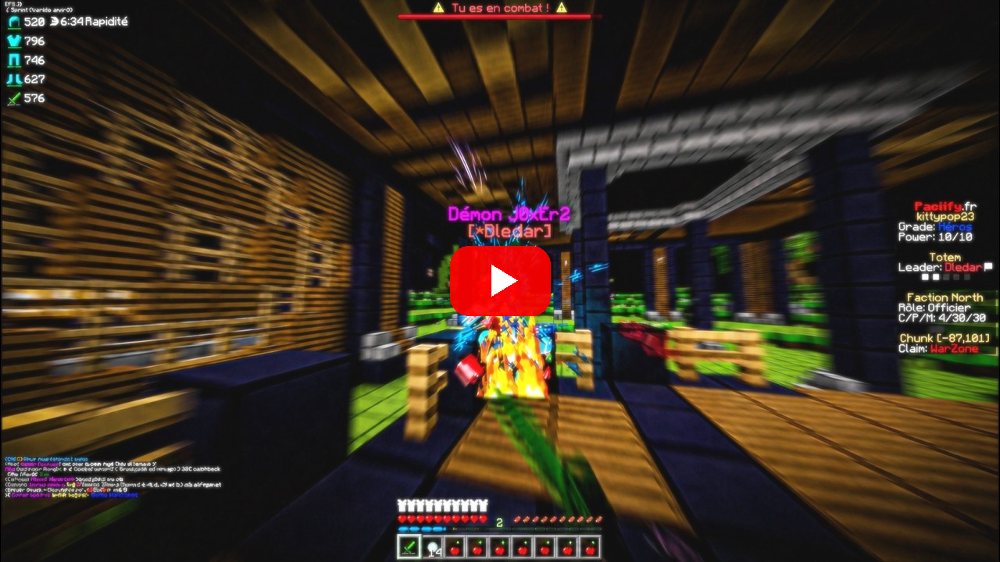
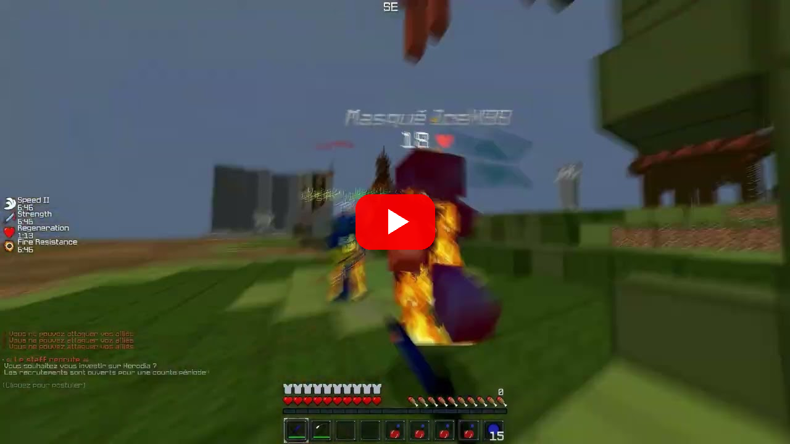
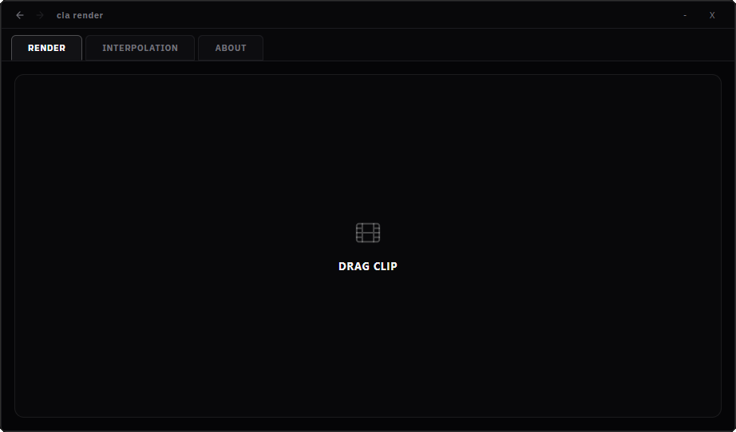

# cia render

cia render is a local Windows desktop app for two video operations:

- **RENDER** - smoothie-rs frame blending and render finishing.
- **INTERPOLATION** - optional RIFE frame multiplication.

Your media stays on the computer. cia render does not upload source videos or
silently fetch render engines.

## Render Preview

<table>
  <tr>
    <td align="center" width="50%">
      <a href="https://www.youtube.com/watch?v=bR7FxKNNV0Y" target="_blank" rel="noopener noreferrer">
        
      </a>
    </td>
    <td align="center" width="50%">
      <a href="https://www.youtube.com/watch?v=8plMwxkAvlA" target="_blank" rel="noopener noreferrer">
        
      </a>
    </td>
  </tr>
</table>

---

## UX



## Getting started

Download the latest Windows installer from the
[releases page](https://github.com/cia213/cia-app/releases). Installing and
launching the app is enough to start using **RENDER** - no setup wizard, no
extra downloads.

**INTERPOLATION** is optional and downloads a separate RIFE environment on
first use. It requires a CUDA-capable NVIDIA GPU. See
[Install and first launch](docs/INSTALL.md) for details.

v1.3.0 verifies the complete RIFE environment before reporting it ready and
provides **REPAIR ENVIRONMENT** for an incomplete or outdated installation.
It also preserves audio tracks and timing, keeps failure diagnostics visible,
and prevents conflicting operations. See the [release notes](docs/RELEASE-v1.3.0.md)
and [validation scope](docs/VALIDATION-v1.3.0.md).

## Build from source

Prerequisites: Node.js 24, Rust stable, Python 3.11 or later, and Windows C++
build tools. The source checks use the committed npm and Cargo lockfiles.

```powershell
npm ci
python scripts/prepare-release.py
npm run tauri dev -- --config src-tauri/target/release-kit-v1.3.0/build.json
```

Prepare the verified render payload and create an NSIS installer:

```powershell
python scripts/prepare-release.py
npm run tauri build -- --config src-tauri/target/release-kit-v1.3.0/build.json
```

The preparation script downloads pinned archives, verifies their hashes, and
stages the payload under ignored `src-tauri/target/`. A plain Tauri build needs
an existing local runtime; use the staged configuration above for distribution.
See [runtime release notes](docs/RUNTIME-RELEASE-NOTES.md) for the licence,
verification and signing requirements.

## Architecture, quality and performance

The [project map](docs/CARTOGRAPHIE.md) and
[quality and performance report](docs/PATCH-QUALITE-PERFORMANCES.md) document
the earlier rendering architecture and measurements. The
[v1.3 audit](docs/AUDIT-v1.3.md) records defects in the v1.2.7 baseline;
the [v1.3.0 release notes](docs/RELEASE-v1.3.0.md) describe the resulting fixes,
and [validation](docs/VALIDATION-v1.3.0.md) states what was exercised.

RIFE now streams interpolated RGB frames directly to FFmpeg. FP32 and software
H.264 remain the defaults; FP16 and NVIDIA H.264 encoding are explicit options.
The current delivery profile is SDR H.264. HDR sources require a separate
tone-mapping workflow. Text subtitles are retained by the RIFE pipeline;
bitmap subtitles are rejected before rendering.

Source-only checks:

```powershell
npm test
npm run build
npm run test:browser
python -m unittest discover -s tests -v
$env:TAURI_CONFIG = '{"bundle":{"resources":["resources/time_remap.py","resources/rife_worker.py","resources/runtime_health.py","resources/bootstrap/bootstrap-rife.ps1","resources/bootstrap/bootstrap-python.ps1","resources/bootstrap/rife-profile.json","resources/bootstrap/rife-requirements.lock"]}}'
cargo fmt --manifest-path src-tauri/Cargo.toml -- --check
cargo clippy --locked --manifest-path src-tauri/Cargo.toml --all-targets -- -D warnings
cargo test --locked --manifest-path src-tauri/Cargo.toml
Remove-Item Env:TAURI_CONFIG
```

On Windows, the private Python bootstrap test downloads and verifies the official
package without changing the system's Python installation or user `PATH`:

```powershell
powershell -NoProfile -ExecutionPolicy Bypass -File tests/test_bootstrap.ps1
powershell -NoProfile -ExecutionPolicy Bypass -File tests/test_bootstrap_generation.ps1
```

The browser suite uses installed Microsoft Edge and mocked Tauri IPC. Native
WebView2 and actual CUDA/media checks are separate, opt-in checks documented in
[validation](docs/VALIDATION-v1.3.0.md).

## Licence and notices

cia render source code is MIT licensed. Third-party software keeps its own
licence; see [THIRD_PARTY_NOTICES.md](THIRD_PARTY_NOTICES.md). Nothing in this
repository grants redistribution rights for an external runtime or model.
Original third-party licence texts are retained unchanged.
