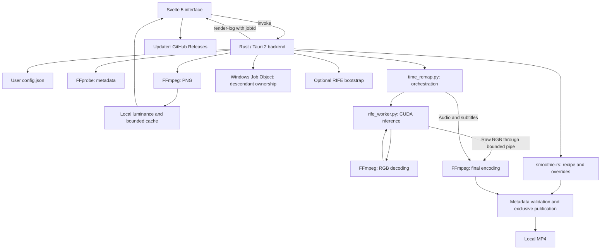

# cia render project map

Patch map finalized on October 1, 2026, declared version **1.2.3**. The application
repository is `time-remap-ui`; `time-remap-app` contains the local Python/RIFE
environment and test media. Binaries, model weights, media, and build outputs
are excluded from Git.

This historical map describes the October 1 patch. Later render speed and
last-frame changes are recorded in [v1.2.5 notes](RELEASE-v1.2.5.md); the current
bootstrap fix is described in [RIFE installation](CORRECTION-INSTALLATION-RIFE.md).

## Architecture

The pages are **RENDER**, **INTERPOLATION**, and **ABOUT**. Media processing is
local. Optional RIFE installation and updates use the network.

## Files and responsibilities

| File | Role |
| --- | --- |
| `src/main.js` | Svelte mounting and fonts |
| `src/App.svelte` | Navigation, configuration, import, job snapshot, progress, previews, installation, and updates |
| `src/GlowSlider.svelte` | Animated slider; animation stops while idle |
| `src-tauri/src/main.rs` | Native entry point |
| `src-tauri/src/lib.rs` | Tauri commands, configuration, metadata, previews, process ownership, output reservation and publication |
| `src-tauri/resources/time_remap.py` | Input contracts, worker/encoder orchestration, audio, subtitles, validation, and cleanup |
| `src-tauri/resources/rife_worker.py` | Selected-model loading, bounded decoding, inference, and RGB streaming |
| `scripts/time_remap_dev.py` | Development entry point for the bundled script, without a separate algorithm copy |
| `src-tauri/resources/bootstrap/bootstrap-rife.ps1` | Optional RIFE runtime installation/adoption |
| `src-tauri/tauri.conf.json` | Window, resources, NSIS, and updater |
| `scripts/build-update.mjs` | Signing a prepared installer and generating its update manifest |
| `.github/workflows/ci.yml` | Windows frontend, Python, and Rust checks using Git-tracked resources |

The ignored runtime contains Smoothie, its plugins/VapourSynth, FFmpeg, and
FFprobe. RIFE is a separate environment containing Python, CUDA PyTorch,
Practical-RIFE, model code, and `flownet.pkl`. The configured model is actually
passed to the worker.

## Interface and backend

| Area | Main commands |
| --- | --- |
| Initialization | `get_runtime_snapshot`, `get_app_version` |
| Configuration | `save_runtime_config`, `save_ui_preferences`, `pick_runtime_path` |
| Import | `open_file_dialog`, `analyze_video` |
| Previews | `generate_video_preview_frame`, `generate_video_preview_set`, `cancel_video_previews` |
| Installation | `install_rife_environment` |
| Processing | `run_time_remap`, `run_smoothie` |
| Control | `pause_render`, `resume_render`, `cancel_render` |
| Opening | `open_target_file`, `open_target_folder`, `open_about_link` |

`render-log` carries `{jobId, line}` to isolate job telemetry. `live-log` remains
in use outside rendering, particularly during installation; `install-progress`
describes bootstrap stages. Tauri drop events handle import.

A job captures its source and settings before starting. History changes
navigation during processing without removing the active job. The backend
reserves one global job before preparation; it rejects a second calculation
even if the frontend requests it. Analysis and preview responses carry request
identifiers so stale responses can be discarded.

## INTERPOLATION flow

1. Resolve tools, validate options, and reserve the job and output name.
2. FFprobe reads the first actual video track, its rational cadence, dimensions, rotation, SAR, duration, and associated streams.
3. The worker loads the configured model code and weights. FP32 remains the default; FP16 is explicit.
4. FFmpeg decodes the selected track, normalizing VFR to average cadence. A bounded queue feeds the model.
5. The model retains RIFE scene/static-frame logic. Interpolated frames go directly to FFmpeg; no intermediate RIFE MP4 or glob search is used.
6. FFmpeg encodes H.264, with x264/CRF18/medium by default. NVENC is optional. Boost multiplies cadence and preserves duration; slowmo preserves cadence and multiplies duration, with an `atempo` audio chain.
7. Compatible audio is copied in boost; other cases use AAC. Text subtitles are converted to `mov_text`, with timestamps stretched in slowmo. Bitmap subtitles are rejected.
8. Exit codes, frame counts, FPS, dimensions, SAR, duration, and audio presence are checked. Output is published exclusively after validation; cleanup is limited to the job-owned directory.

The worker produces **N × factor** frames by holding the final frame to complete
the tail. The old engine generally produced `(N−1) × factor + 1` frames. Quality
comparisons use only common frame indices.

The delivery profile is SDR 8-bit H.264. HDR PQ/HLG is rejected before rendering;
an explicit transfer conversion is still required. The backend currently
rejects odd dimensions. The standalone Python tool can pad them.

## RENDER flow

Rust passes the configured recipe, validated settings, configured LUT path, and
encoder. Non-neutral colour settings actually activate processing. Encoding
arguments preserve source dimensions and SAR; in this October 1 implementation,
recipe speed changes are reset to 1 to match the duration displayed by the app.
v1.2.5 later restores adjustable speed, documented separately above.

Smoothie writes into a reserved directory. Nonempty output and exit code zero
are insufficient: FPS, dimensions, SAR, duration, and audio are checked before
publication. The runtime can report success despite a filter error; this
validation catches outputs containing only audio, among other failures.

Auto-render runs Smoothie on the RIFE result with the initial settings snapshot.
If the second stage fails, the validated RIFE result remains accessible. The
final preview is decoded from the actual output.

## Previews and processes

A cover is loaded on import; eight additional timeline previews are requested
on hover. Eight PNG extractions replace the old sixteen FFmpeg invocations;
luminance is computed in Rust. The cache holds at most four sets, identified by
path, size, modification time, duration, and tool. Stale requests can be
cancelled; repeated approximate previews during rendering are removed.

Engines are created suspended, assigned to a **Windows Job Object** with
kill-on-close, then resumed. Guards own the job's processes and files.
Cancellation, shutdown, errors, and abandonment stop descendants before cleanup.
Pause/resume controls the process group. Retained logs are bounded.

## Data and outputs

| Data | Location or owner |
| --- | --- |
| `RuntimeConfig` | `config.json` in Tauri's configuration directory; RIFE, Smoothie, media-tool, and UI sections |
| Configuration writes | Serialized, unique temporary file and atomic replacement; unreadable configuration is not overwritten with defaults |
| Installed RIFE runtime | Tauri data directory, `runtimes/rife/` |
| Jobs and previews | Application memory and native guards |
| Render temporary files | Unique directory owned by the reservation |
| Boost output | `clip-240fps.mp4` |
| Smoothie output | `clip_render30fps.mp4` |
| Collision | Suffix `(1)`, `(2)`…; publication without overwriting |

## Validation and maintenance

See [PATCH-QUALITE-PERFORMANCES.md](PATCH-QUALITE-PERFORMANCES.md) for executed
tests, runtime restrictions, and measured performance;
[AUDIT-QUALITE-PERFORMANCES.md](AUDIT-QUALITE-PERFORMANCES.md) retains the findings
of the initial revision.

`App.svelte` and `lib.rs` remain the two main monoliths. Future maintenance can
extract configuration, jobs, previews, and settings models into dedicated
modules. Ignored runtimes remain necessary for real tests and distribution;
source-only CI does not certify a complete installer.
